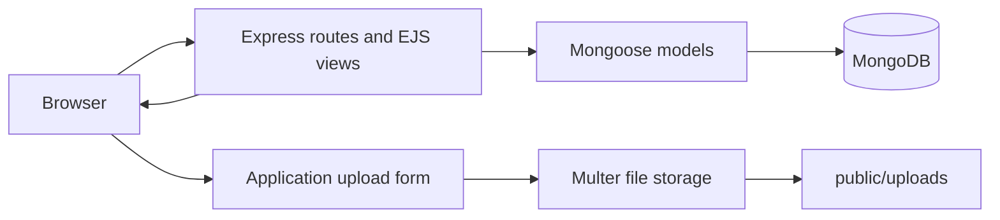

# Online Job Finder

**A server-rendered job board for applicants and recruiters.**

## Overview

This Express application uses EJS views and MongoDB to display job listings, accept applications, and support recruiter job posting. It includes account registration and session-based login with applicant and recruiter roles.

## Key features

- Browse job posts and view job details.
- Register and log in as an applicant or recruiter.
- Submit an application with a resume and certificate uploads.
- Post jobs from the recruiter flow.
- Send job-related messages through the contact form.

## Tech stack

Node.js, Express, EJS, MongoDB, Mongoose, express-session, Multer, and Sharp.

## Architecture and workflow



## Project structure

```text
.
├── routes/index.js       # Express routes and server listener
├── models/               # Users, jobs, applications, and contacts
├── views/                # EJS pages
├── public/               # Styles, images, scripts, and uploads
└── package.json
```

## Installation and execution

Requires Node.js, npm, and MongoDB running locally. The current connection in `models/script.js` targets `mongodb://127.0.0.1:27017/LoginDB`.

```bash
npm install
node routes/index.js
```

Then open [http://localhost:4000](http://localhost:4000).

## Screenshots and demo

No screenshots or deployed demo link are included.

## Author

**Gireesh Sadanand Patgar** · [GitHub](https://github.com/gireeshpatgar17)