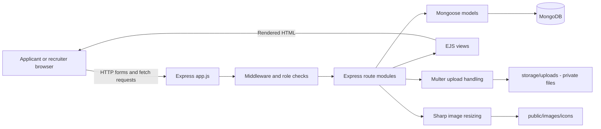

# Online Job Finder

[](#technology-stack)
[](#technology-stack)
[](#technology-stack)
[](#technology-stack)
[](#project-status)

A server-rendered job board where applicants can find jobs, submit and track applications, and recruiters can publish and manage their own listings.

## Contents

- [Features](#features)
- [Technology stack](#technology-stack)
- [Architecture](#architecture)
- [Getting started](#getting-started)
- [Configuration](#configuration)
- [Project structure and file guide](#project-structure-and-file-guide)
- [Data and security](#data-and-security)
- [Project status and limitations](#project-status-and-limitations)

## Features

### Applicants

- Create an account and sign in with the applicant role.
- Search active jobs by title, role, company, location, or description.
- Filter listings by employment type, seniority, and annual INR salary band. Counts come from database records and update with the current search and filters.
- Sort by newest, oldest, highest salary, or nearest deadline.
- Browse paginated results, with 10 jobs per page.
- Apply to an open job with education, experience, skills, a resume, and optional certificates or portfolio links.
- Submit only one application per job. Repeat attempts show that the application already exists.
- Track submitted applications and recruiter-updated statuses from **My applications**.
- Send a job-specific message to its recruiter.

### Recruiters

- Create an account and sign in with the recruiter role.
- Publish a job with location, employment type, seniority, annual INR salary range, and application deadline.
- View, edit, close, or reopen their own job posts. Closed and expired jobs are not available for applications.
- Review applications for their own jobs, update application status, and download resumes and certificates.
- View, mark read, and delete job-specific messages.
- Delete a job and its associated applications, uploaded application files, and messages.

### Sample data

At startup, the application inserts 20 sample job listings if their seed keys are not already in the database. The seed operation is idempotent: restarting the app does not add another copy. Listings use a system sample recruiter that cannot sign in.

## Technology stack

| Technology | Use in this project | Why it fits |
|---|---|---|
| Node.js | JavaScript runtime | Runs the server and keeps the application logic in JavaScript. |
| Express 5 | HTTP server, middleware, and routes | Provides a small routing layer for account, job, application, contact, and recruiter flows. |
| EJS | Server-rendered HTML templates | Renders database results into pages without a separate frontend build or client-side framework. |
| MongoDB | Persistent data store | Stores users, jobs, applications, and messages as documents suited to evolving form data. |
| Mongoose | MongoDB models and validation | Defines document schemas, references, enums, validation, indexes, and query helpers. |
| express-session | Login sessions | Keeps role and account identity between requests using an HTTP-only session cookie. |
| bcrypt | Password hashing | Stores password hashes rather than raw passwords. |
| Multer | Resume and certificate uploads | Handles multipart form uploads with file-count and file-size limits. |
| Sharp | Job-card icon resizing | Creates smaller listing icons from the provided image assets when needed. |

Versions and package metadata are defined in `package.json`; `package-lock.json` pins the dependency graph for repeatable installation.

## Architecture

The application uses a modular, server-rendered MVC-style structure. Express routes coordinate requests and database operations; Mongoose models define persistence; EJS views render HTML. The route handlers currently contain the application workflow logic directly—there is no separate service layer or JSON API.



### Request flow

1. The browser requests a page or submits a form.
2. `app.js` parses the request, loads the session, and exposes the signed-in user to templates.
3. A route performs role and ownership checks, validates input, and reads or writes MongoDB through a model.
4. Routes render an EJS page or return a redirect/JSON response.
5. Resume and certificate files are stored outside the public static directory. Download routes verify that the signed-in recruiter owns the job before returning a file.

## Getting started

### Requirements

- Node.js 18 or newer and npm.
- MongoDB running locally or a reachable MongoDB connection string.
- PowerShell on Windows, or a terminal that can set environment variables.

### Windows PowerShell

From the project directory:

```powershell
cd C:\Others\Projects\DBMS_Project\Online_Job_Finder_Final
npm ci
$env:MONGODB_URI = "mongodb://127.0.0.1:27017/onlineJobFinder"
$env:SESSION_SECRET = "replace-this-with-a-long-random-local-secret"
npm start
```

Open [http://localhost:4000](http://localhost:4000). Keep the terminal running while using the app. Stop the server with **Ctrl+C**.

### macOS or Linux

```bash
cd Online_Job_Finder_Final
npm ci
export MONGODB_URI="mongodb://127.0.0.1:27017/onlineJobFinder"
export SESSION_SECRET="replace-this-with-a-long-random-local-secret"
npm start
```

The default port is `4000`. Set `PORT` before `npm start` to use another port. MongoDB will create the database and collections as the app writes data.

## Configuration

| Variable | Required | Default | Purpose |
|---|---|---|---|
| `MONGODB_URI` | No for local development | `mongodb://127.0.0.1:27017/onlineJobFinder` | MongoDB connection string. |
| `SESSION_SECRET` | Required in production | Local-development fallback | Secret used to sign session cookies. Use a long, random value and keep it out of source control. |
| `PORT` | No | `4000` | HTTP port for the Express server. |
| `NODE_ENV` | No | Node.js default | Set to `production` when deploying; session cookies are then marked secure. |

The project does not load `.env` automatically. Set variables in the shell or add a dotenv package and initialization if you want `.env` support. `.env` is ignored by Git.

## Project structure and file guide

```text
Online_Job_Finder_Final/
├── app.js                         # App setup and startup
├── package.json                   # Scripts and dependency ranges
├── package-lock.json              # Locked npm dependency versions
├── README.md                      # Setup, design, features, and file guide
├── MERGE_NOTES.md                 # Consolidation history and feature notes
├── .gitignore                     # Excludes dependencies, secrets, and uploads
├── models/                        # MongoDB schemas and connection
├── routes/                        # HTTP endpoints and request workflows
├── views/                         # EJS page templates
├── public/                        # Browser assets served publicly
│   ├── functions.js               # Application form browser behavior
│   ├── style.css                  # Shared styles for legacy form/detail pages
│   └── images/                    # Job card source and resized icons
└── storage/uploads/               # Private application attachments
```

### Root and configuration files

| File | Purpose |
|---|---|
| `app.js` | Configures Express, sessions, static files, parsers, route modules, error handling, database connection, seeding, and server startup. |
| `package.json` | Declares the app metadata, `npm start` script, Node requirement, and direct dependencies. JSON does not permit comments; this table documents it. |
| `package-lock.json` | Locks exact npm dependency versions. It is generated JSON and must not contain comments. |
| `.gitignore` | Keeps `node_modules`, `.env`, and uploaded applicant files out of Git while retaining the upload placeholder. |
| `MERGE_NOTES.md` | Records which source project features were consolidated and the follow-up improvements. |
| `README.md` | Project documentation, including this file map. |

### Models

| File | Purpose |
|---|---|
| `models/db.js` | Connects Mongoose to the configured MongoDB database. |
| `models/user.js` | Defines user accounts, roles, company details, and the unique username index. |
| `models/jobpost.js` | Defines job listing fields, salary, deadlines, ownership, open/closed status, and seed keys. |
| `models/application.js` | Defines application form data, applicant/job references, application status, timestamps, and one-application-per-applicant/job index. |
| `models/contact.js` | Defines job-specific messages and their sender, recruiter, and read status. |
| `models/seedJobs.js` | Idempotently creates the sample recruiter and 20 complete listings. |

### Routes

| File | Purpose |
|---|---|
| `routes/main.js` | Builds the public job search, filters, facets, sorting, counts, and pagination. |
| `routes/auth.js` | Handles signup, login, password verification, sessions, logout, and safe redirects. |
| `routes/middleware.js` | Restricts routes to signed-in users with the required role. |
| `routes/job.js` | Validates, creates, edits, and displays job posts and their details. |
| `routes/application.js` | Handles application form display/submission, duplicate checks, application tracking, uploads, and protected recruiter downloads. |
| `routes/contact.js` | Accepts job-specific questions and stores them for the job owner. |
| `routes/recruiter.js` | Renders the recruiter dashboard and handles job status, deletion, application status, and message actions. |

### Views and public assets

| File or directory | Purpose |
|---|---|
| `views/index.ejs` | Applicant job search, filters, sorting, and paginated listings. |
| `views/login.ejs` | Login form and authentication feedback. |
| `views/signup.ejs` | Applicant/recruiter account registration form. |
| `views/job-details.ejs` | Full details and actions for a selected listing. |
| `views/postjob.ejs` | Recruiter job creation and edit form. |
| `views/apply.ejs` | Applicant form, duplicate-application notice, and submission result. |
| `views/my-applications.ejs` | Applicant’s submitted jobs and current statuses. |
| `views/contact.ejs` | Job-specific message form and feedback. |
| `views/recruiter-dashboard.ejs` | Recruiter-owned posts, applications, statuses, attachments, and messages. |
| `public/functions.js` | Browser-side application form behavior, including age calculation. |
| `public/style.css` | Shared CSS loaded by the application and job-detail pages. |
| `public/images/job-offer.png`, `posting.png`, `promotion.png`, `search.png` | Source icons resized for job cards. |
| `public/images/cv.png` | Additional CV graphic asset; it is not currently referenced by the templates. |
| `public/images/icons/resized-*.png` | Pre-generated compact job-card icons. |
| `storage/uploads/.gitkeep` | Keeps the private upload directory present in a fresh checkout. Actual uploaded files are ignored by Git. |

PNG image files cannot contain useful source comments; their roles are documented here. EJS templates include HTML purpose comments, and source modules include short purpose comments at the top.

## Data and security

- User passwords are hashed with bcrypt.
- Role checks protect applicant and recruiter routes; job-management actions are scoped to the signed-in recruiter’s own posts.
- Application records have a unique compound index on applicant and job, backing up the route-level duplicate check.
- Uploads have a 5 MB per-file limit and accept PDF, Word, PNG, and JPG/JPEG files. They are stored in `storage/uploads`, not `public`.
- Recruiter download routes check job ownership before serving applicant files.
- Session cookies are HTTP-only and use `sameSite: lax`; production cookies use the `secure` flag.
- Configure a strong production `SESSION_SECRET` and use HTTPS in deployment.
- Deleting a job deletes its related applications, uploaded files, and job messages.

## Project status and limitations

- This is a learning/demo project. Express’s default in-memory session store is used; deploy with a persistent session store for production.
- The app does not send email notifications and has no administrator role or moderation console.
- Database records from the earlier `LoginDB` and `jobFinderDB` projects are not migrated automatically.
- The sample recruiter account is for listing ownership only and cannot be used to sign in.
- No license has been specified. Add a `LICENSE` file before redistributing the project if needed.
